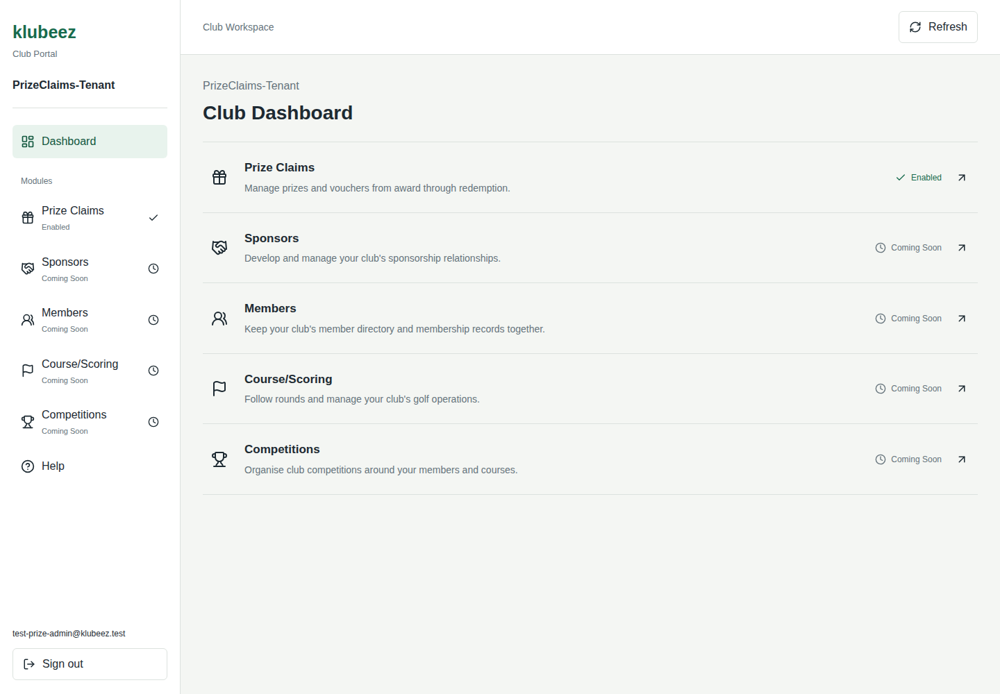
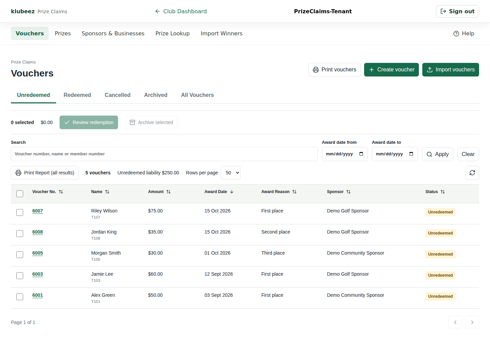
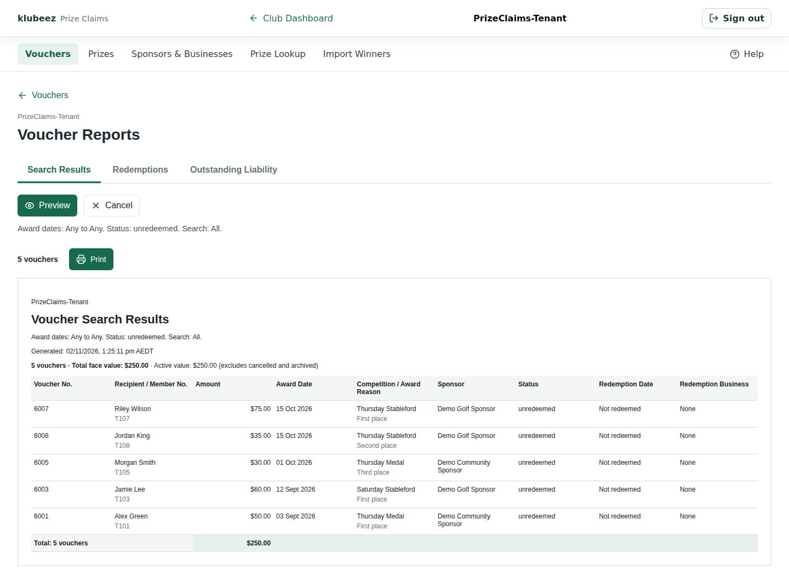
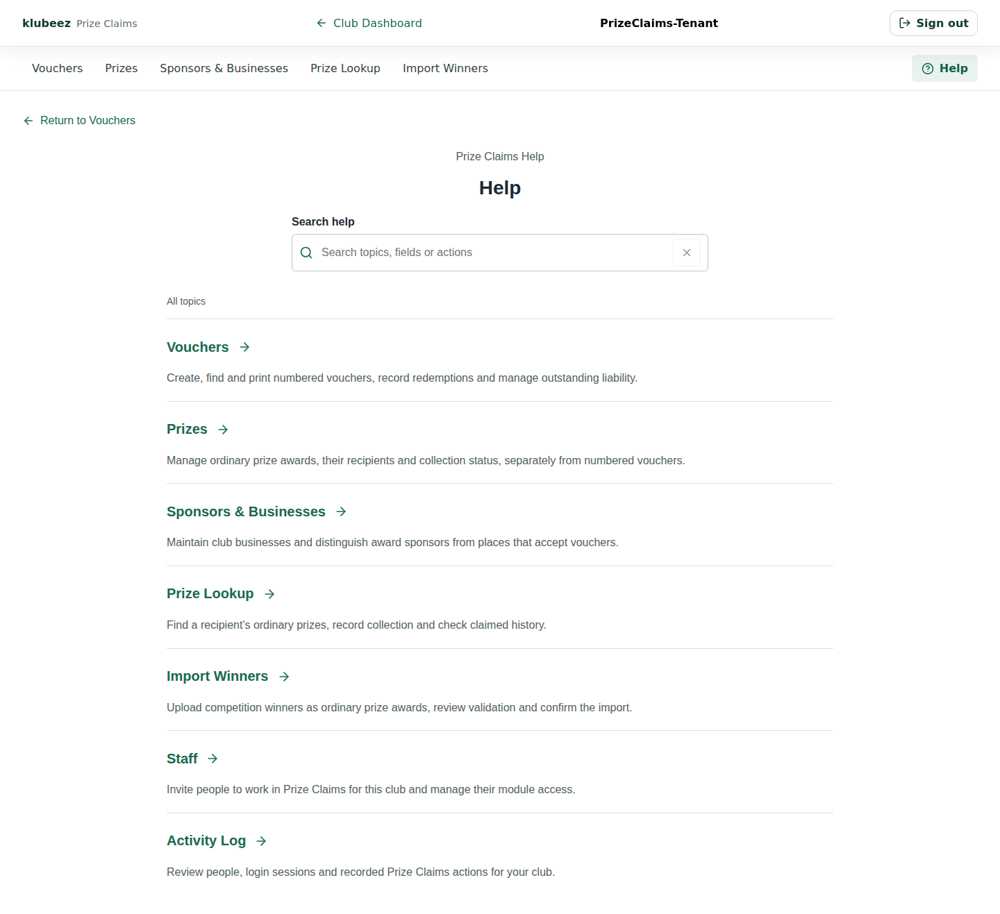

# klubeez

**Club management, with Prize Claims as the first operational module.**

klubeez brings club operations into one portal. Clubs see the module catalogue,
open the modules they can use, and work within their own club's boundaries.
The current focus is replacing an Access-based voucher workflow with
browser-based creation, redemption, printing and reporting.

This is a **public portfolio**, not application source or a runnable demo.
The product remains **pre-launch**, with local and hosted Dev testing.
Screenshots show real application screens using synthetic test records.
No customer records, credentials or private deployment configuration are included.

## What Works Today

| Area                     | Capabilities                                                                                                                               |
| ------------------------ | ------------------------------------------------------------------------------------------------------------------------------------------ |
| Club Portal              | Shared sign-in, club-aware dashboard, module catalogue and direct access to enabled modules without another login                          |
| Vouchers                 | Create and edit, automatic per-club numbering, member lookup or non-member recipients, CSV import and status/date/search filters           |
| Redemption And Archiving | Individual or bulk redemption at club-selected businesses; cancellation and archiving retain records                                       |
| Printing And Reports     | A4 two-per-sheet or A5 landscape vouchers, issuer/watermark settings, search-results reports, redemption reports and outstanding liability |
| Prizes                   | Ordinary awards, winner imports, lookup and recorded collection, separate from numbered vouchers                                           |
| Sponsors & Businesses    | Shared club business register with explicit selection of voucher redemption venues                                                         |
| Administration           | Club/platform administrator controls for staff invitations, staff module access, voucher display and recorded activity                     |
| Help                     | Searchable explanations of screens, fields and workflows, maintained alongside feature changes                                             |

Staff accounts do not require club membership. Club/platform administrators
have additional controls; ordinary staff cannot invite other staff. Access is
enforced by backend authorization, not just hidden navigation.

Membership and golf-scoring capabilities exist in the broader codebase, but
are not the current launch focus. A module shown as **Coming Soon** is not
available to that club. Historical data preparation, production readiness and
administrator handover remain separate launch work.

## Product Screenshots

Captured **2 November 2026** from hosted Dev. The module images show a staff
view, not administrator-only controls. [Screenshot provenance](images/README.md).

### Club Dashboard

One entry point for club modules and their availability.

### Voucher Directory

Status tabs, search, date filters, selection and actions in one operational view.

### Voucher Reports

Printable report previews with relevant filters, voucher details and totals.

### Searchable Help

Workflow guidance is part of the product, not a separate training document.

## My Role

**Founder, Product Lead And Engineering Lead**

I translate club workflows into requirements and acceptance tests, direct
AI-assisted implementation, review the resulting experience, and make delivery
and release decisions. My responsibilities include product direction, UX,
tenant boundaries, data modelling and the development-to-deployment process.

The approach is practical: small changes, explicit acceptance criteria,
automated checks, relevant browser validation, and human testing before approved
hosted rollouts. AI review findings are assessed against real supported workflows
rather than treated as automatic instructions.

## Architecture And Stack

- React, TypeScript and Vite for the portal and separately built Prize Claims frontend.
- Supabase for shared authentication, database and backend access controls.
- Vercel for hosted frontend delivery and portal/module routing.
- GitHub for version control, pull requests and application CI.
- Codex-assisted engineering with human-owned scope, acceptance and merges.

The platform owns shared tenants, identities, businesses and database migrations.
Prize Claims consumes those capabilities rather than duplicating them. Users
enter through the portal; a separate frontend does not mean a separate account.

## Explore The Portfolio

- [Product Summary](docs/product-summary.md): business context and current scope.
- [Architecture Overview](docs/architecture-overview.md): application boundaries and access model.
- [Engineering Approach](docs/engineering-approach.md): current delivery principles.
- [Documentation Index](docs/README.md): current overviews and historical process snapshots.
- [Code Samples](samples/README.md): historical, sanitized extracts, not runnable modules or the current authentication implementation.

The working application repositories are private. This repository contains only
selected public documentation, images and illustrative samples. It has no
application build or deployment pipeline; updating this portfolio does not
deploy klubeez.
