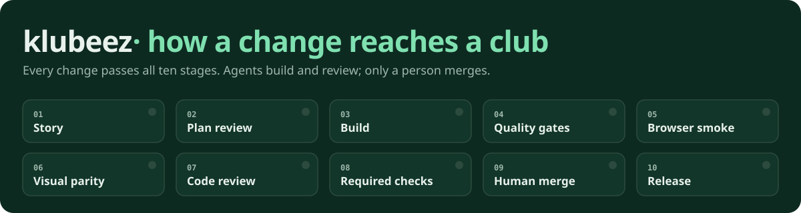
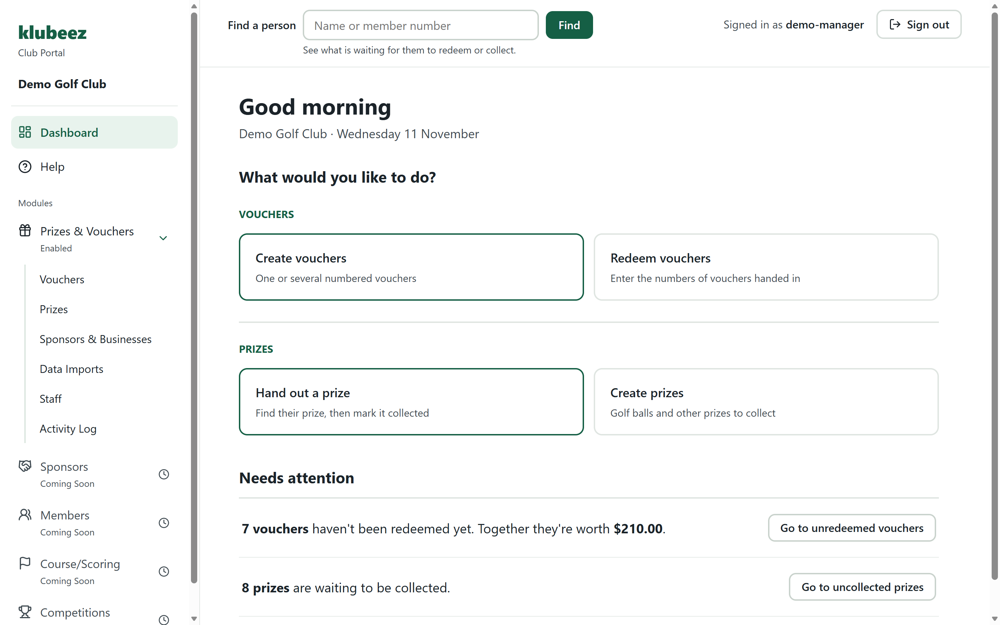
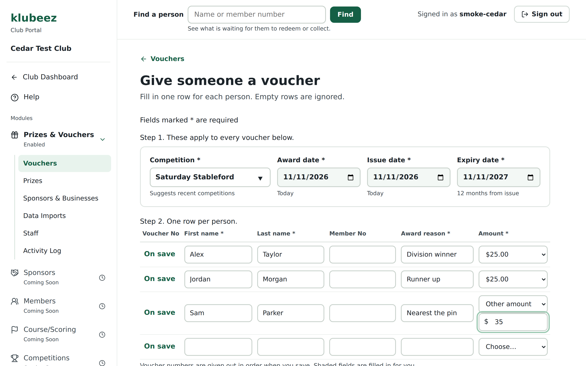
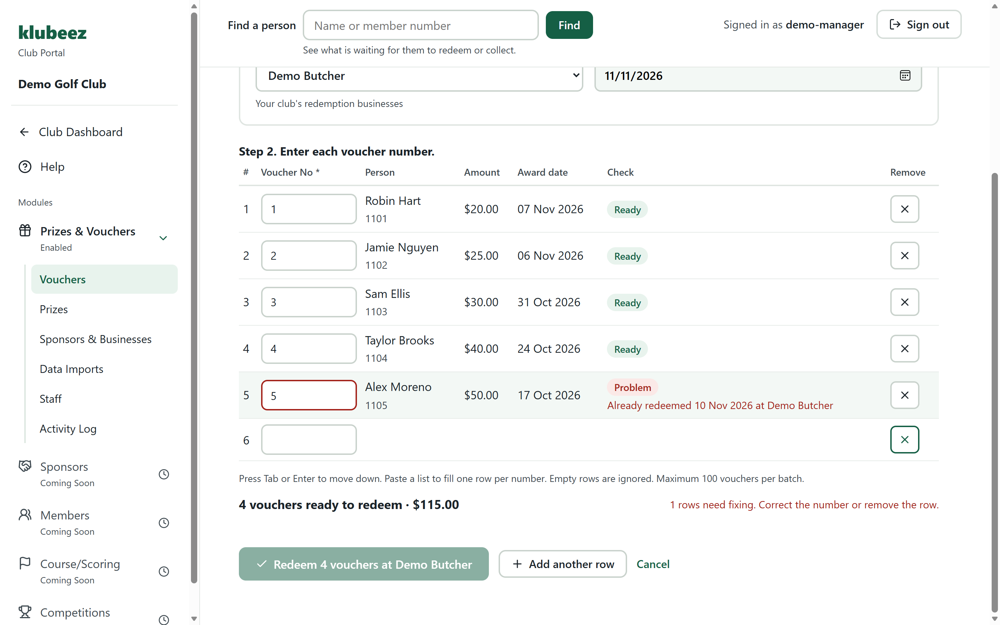
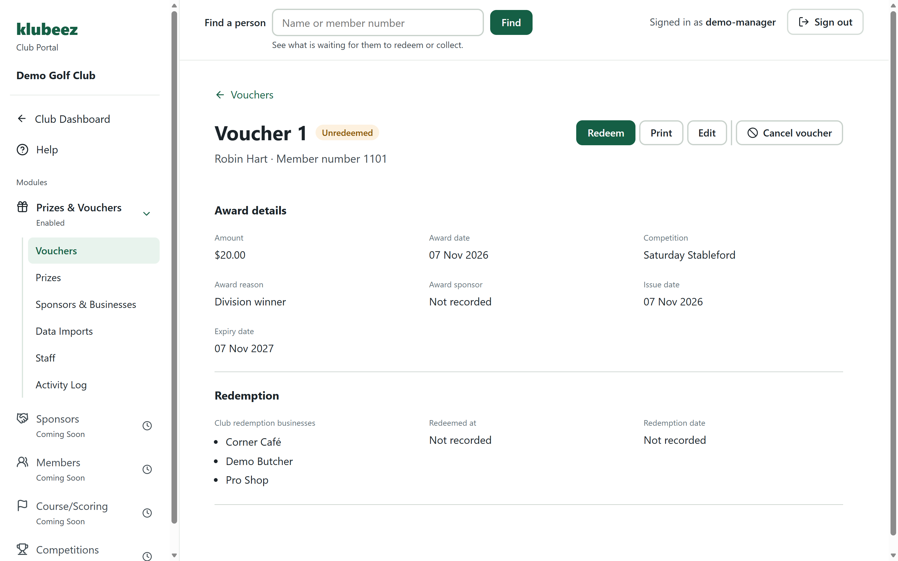
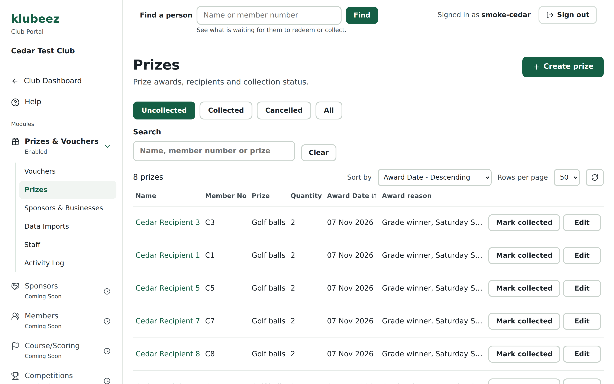
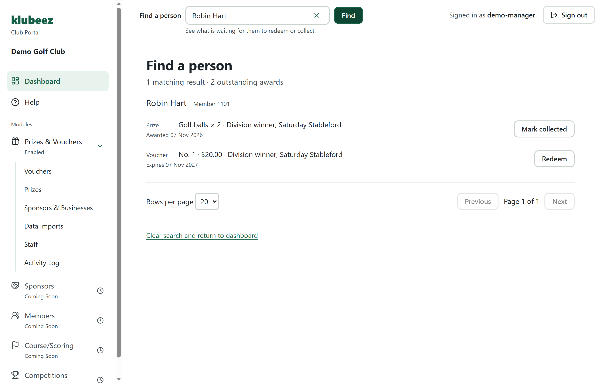

<p align="center"></p>

# klubeez

**One calm, simple portal for club operations. Built the right way.**

klubeez replaces paper vouchers, spreadsheets and disconnected legacy processes
for club staff, starting with prize vouchers and prizes.

It saves hours every week, stops vouchers going missing, and keeps every record
in one place. And every change is tested, reviewed and approved before it
reaches a club.

## The story so far ...
| 637 | 1,579 | 28 | 37 | 101 | 4 |
| :-: | :-: | :-: | :-: | :-: | :-: |
| pull requests, each reviewed and merged by a person | automated tests on every change | browser checks against a real database in CI | architecture decision records | database migrations, replayable from zero | required checks no one can bypass, administrators included |

<sub>Figures as of 11 November 2026.</sub>

## The Saturday Jobs, Done In One Screen

After a competition, a staff member hands out prizes and vouchers. During the
week, local businesses hand vouchers back to be paid. klubeez makes both quick,
checked and impossible to half-finish.

- **A whole competition in one screen.** Enter the competition once, then one
  row per winner. Dates, numbers and expiry fill themselves in. One save
  creates them all, or none.
- **Every voucher checked as you type.** Already redeemed, cancelled, entered
  twice or not usable at that business: each problem is named in plain words
  before anything is saved.
- **Find a person.** One search shows everything waiting for a member to redeem
  or collect, with the action right there.
- **Printing, reports and liability.** Branded A4 or A5 vouchers with the club's
  watermark, redemption reports by business, and the club's outstanding
  liability at a glance.
- **Help that ships with every change.** Every feature arrives with its Help
  written for club staff. It is a rule of the pipeline, checked in review.

Designed to best practice: clear hierarchy, generous text and targets,
consistent layouts, plain language, accessible colour contrast checked
automatically, keyboard-friendly data entry and one obvious next step on every
screen.

### Product Screens

Screens use synthetic records only. [Screenshot provenance](images/README.md).

| | |
| --- | --- |
|  |  |
| **Dashboard.** The everyday jobs first, and what needs attention. | **Create vouchers.** A whole competition's winners in one save. |
|  |  |
| **Redeem vouchers.** Every number checked before anything is saved. | **Voucher details.** Status, person and the right actions at a glance. |
|  |  |
| **Prizes.** Golf balls and other prizes waiting to be collected. | **Find a person.** Everything waiting for one member, in one search. |

### Modules And Pricing

**Prize Claims** is the first module. **Raffles, Events and Sponsors**
are coming.

**$25 per week per module**, ex GST · up to 5 staff logins · cancel at any time.

## How A Change Reaches A Club

Codex writes the code. Claude reviews it, read-only. Machines check everything
that can be checked. A person merges. Nothing reaches a club without passing
every one of these stages, and each stage leaves evidence behind.

| Stage | What happens |
| --- | --- |
| **1. Story and expected outcome** | Every task starts as a user story with acceptance criteria and a written expected outcome, so "done" is defined before any code exists. |
| **2. Plan review** | Claude Code reviews the plan against the real source. It can only read: no shell, no edits, no secrets, proven with a canary before its first review. |
| **3. Build** | Codex implements the smallest agreed increment on a branch, with focused tests that assert the accepted contract, not just whatever the code happens to do. |
| **4. Quality gates** | Formatting, lint, type checks, 1,579 tests, production build, security configuration check, dependency audit. |
| **5. Browser smoke** | 28 Playwright checks run the key club workflows against a throwaway Postgres built from the migrations, in CI, on every change. |
| **6. Visual parity** | Screens are captured at 1280, 1440 and 1920 wide with synthetic data and compared against the approved design pack. |
| **7. Candidate review** | Claude reviews the actual diff and test evidence. At most three rounds, then one check-only pass. Findings are fixed, deferred with a backlog link, or rejected with reasons. |
| **8. Required checks** | Four required checks, branches up to date, rules enforced for administrators too. Conversations must be resolved before a merge. |
| **9. Human merge** | No agent can merge or push to the main branches. The product owner tests locally against a written test guide, then merges. |
| **10. Release** | Released to Test on synthetic data with post-deploy checks. Production is a separate, named approval. Approval to write code is never approval to deploy it. |

**Required on every pull request**, from GitHub Actions only, so nothing else can
post a fake pass: `quality-gates` · `browser-smoke` · `quick-scope` · `quick-visual`.

**The Reality Gate.** Before any finding is acted on, the reviewer names the
actor, the exact sequence, the visible outcome and the boundary at risk.
Findings that need customers or traffic that don't exist are rejected. Real
security, privacy and data risks never are.

**Severity with teeth.** P0 stop · P1 prompt fix · P2 may block · P3 minor. A
label is not proof. A failed acceptance criterion blocks, whatever its severity.
Protected risk can only be accepted by the product owner, in writing.

## The Quick-Change Channel

When a club asks for a wording tweak on a Tuesday, it can be live on Test in
minutes. `kz` makes wording, colour and component-style changes from one
terminal command. Each one is previewed, checked, merged under the owner's
account and deployed to Test, with no AI session involved and no shortcut
through the gates.

```text
$ kz word dashboard_create_vouchers_detail "Type in several winners at once"
  ✓ words file only · placeholders intact · no markup
  ✓ local checks: format, lint, types, 1,579 tests
  ✓ before/after pictures: 1280 · 1440 · 1920 · narrow
  Send to Test? (y/n) y
  trusted scope check: lane = words · attested
  required checks: 4 of 4 passed
  ✓ merged by the owner · deployed to Test
$ kz undo
  ✓ reverted through the same lane
```

The scope check is the real control. It runs only trusted code from the main
branch and inspects the change as data, never running it. kz refuses page code,
links or layout; broken placeholders; low contrast or hidden content; approval
piped from a script; releasing unfinished work; and Production by accident.

## Architecture

A modular monolith on proven managed services, with the database as the final
authority on who can see and change what.

- **One web application.** React 19, TypeScript and Vite, with Prize Claims as
  the first module and shared packages for people, businesses, UI and the module
  contract. All wording lives in one words file; all styling in design tokens.
- **Server-owned sessions.** Sessions are managed by the server through HttpOnly
  cookies. No bearer tokens are ever kept in browser storage.
- **Postgres with row-level security.** Supabase, RLS on every table and
  RPC-authoritative writes. Permissions are enforced in the database, not just
  by hiding buttons.
- **Tenant isolation is tested, not assumed.** Data features ship with tests
  that try to read another club's records and must fail.
- **All or nothing.** Creating eighteen vouchers or redeeming twenty is one
  database transaction, with double-click protection and a server-side recheck
  of every row.
- **One owner per fact.** A data-ownership map says which module owns people,
  staff and businesses, so nothing gets copied and drifts.
- **Decisions written down.** 37 architecture decision records explain why
  things are the way they are.
- **Second use extracts.** The first time something is built, it lives in its
  module. The second time, it moves to a shared package rather than being copied.

## Best Practice, Built In

- **Separate environments.** Local, Test and Production are fully separate.
  Testing only ever uses synthetic data, never a club's records.
- **Rebuilt the same way, every time.** Every environment is built from scratch
  from version-controlled database migrations, so Production is never a one-off.
- **Real workflows tested on every change.** Key club workflows run in a real
  browser against a real, throwaway database before any change can merge.
- **Recorded testing.** Every feature staff use has a written test guide, and
  every run is saved with who tested it, on which build, with what result.

## Explore

- [Product summary](docs/product-summary.md)
- [Architecture overview](docs/architecture-overview.md)
- [Engineering approach](docs/engineering-approach.md)
- [Documentation index](docs/README.md), including historical process snapshots
- [Code samples](samples/README.md): historical, sanitized extracts

The application source is private. This public repository contains no customer
records, credentials or private configuration, and updating it does not deploy
klubeez. Product examples use synthetic data.
